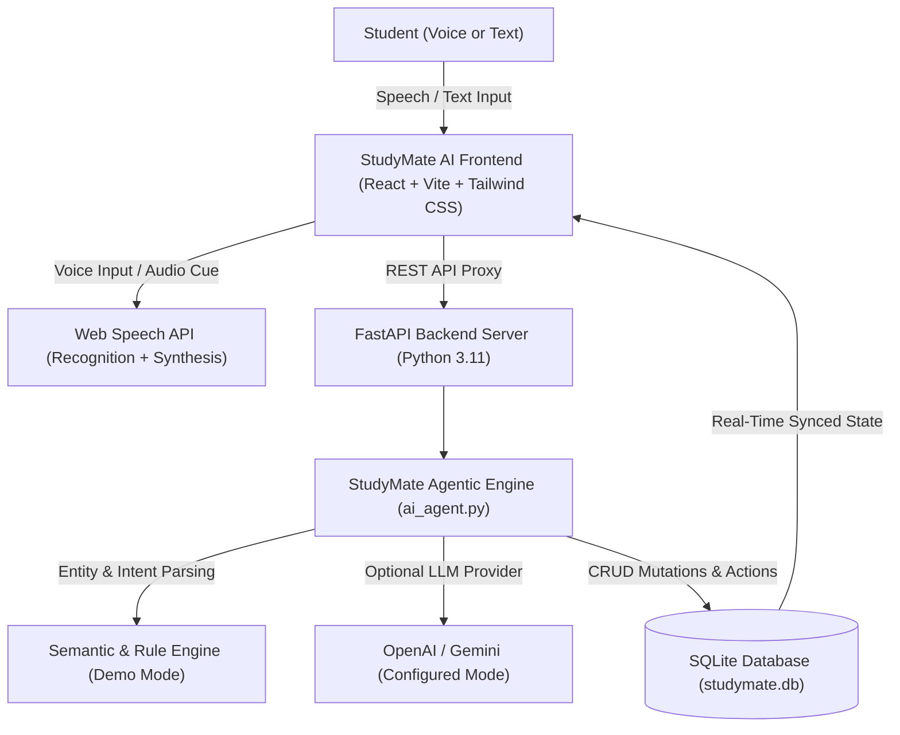

# StudyMate AI — Alexa+-Inspired Student Assistant
> **Simulated Alexa+ Student Copilot for the Amazon Developer Hackathon**
> *An independent educational product simulation designed to demonstrate conversational natural-language intent-to-action agent workflows.*

---

## 1. Project Overview

**StudyMate AI** is an intelligent student productivity assistant inspired by the conversational, agentic capabilities of **Alexa+**. Rather than merely generating conversational text, StudyMate AI actively translates natural speech and text requests into real application actions—generating multi-day study roadmaps, creating scheduled tasks with deadline notifications, dynamically assembling interactive quizzes, and computing real academic analytics.

### Key Capabilities
- **Simulated Alexa+ Natural Language Agent**: Understands student queries, classifies intents, extracts key parameters (subjects, durations, times), and executes database operations.
- **Action Confirmation Cards**: Responses embed interactive cards (e.g., Study Plan, Scheduled Task, Quiz Runner) with direct navigation buttons.
- **Hands-Free Voice Experience**: Browser-native Speech Recognition (`webkitSpeechRecognition`) and Text-to-Speech (`speechSynthesis`) with audio feedback chimes via the Web Audio API.
- **Study Curriculums & Plans**: Multi-day timeline roadmaps with daily task breakdowns and real-time progress calculations.
- **Task & Reminder Management**: Filterable task list (All, Today, Upcoming, Completed) with priority flags, overdue detection, and browser notifications.
- **Interactive Quiz Center**: Self-assessment question bank across Java OOP, Data Structures & Algorithms, DBMS, and Operating Systems with instant score feedback and confetti celebrations.
- **Progress Analytics**: Real-time charts powered by Recharts (weekly hours, subject mastery breakdown, quiz logs, and study streaks).
- **Graceful Fallbacks & Demo Mode**: Operates seamlessly out-of-the-box in Demo Mode without requiring paid third-party API keys, while supporting OpenAI and Google Gemini LLMs when configured.

---

## 2. Architecture & Design



### Visual Identity
- **Color Palette**: Deep midnight navy (`#0B0F19`), rich slate accents (`#0F172A`, `#1E293B`), electric cyan (`#22D3EE`), and neon indigo/violet gradients (`#6366F1`, `#8B5CF6`).
- **Typography**: Inter (modern sans for high readability) and Outfit (geometric headings).
- **Micro-interactions**: Translucent glassmorphism panels, animated audio frequency bars, and synthesized Web Audio feedback chimes.

---

## 3. Natural Language Intent-to-Action Mapping

| Student Natural Language Query | Intent Detected | Real Executed Action |
| :--- | :--- | :--- |
| *"Create a 5-day DSA study plan. I can study 2 hours daily."* | `STUDY_PLAN_CREATED` | Creates 5 daily modules with exercises, saves to SQLite, embeds Study Plan card |
| *"Remind me to practice arrays at 6 PM."* | `TASK_CREATED` | Schedules task under Data Structures with today's date & 18:00 due time |
| *"Mark my arrays task as completed."* | `TASK_COMPLETED` | Finds pending arrays task, updates status to done, recalculates completion rate % |
| *"Explain the difference between a stack and a queue."* | Conceptual Explanation | Outputs formatted markdown comparison table, Java code example, and practical usage |
| *"Create a quiz about Java OOP."* | `QUIZ_GENERATED` | Generates 5 curated multiple-choice questions, embeds interactive Quiz Card |
| *"How much of my study plan have I completed?"* | `PROGRESS_SUMMARY` | Calculates total completed tasks, hours studied, streak, and quiz averages |
| *"Help organize a daily schedule"* | `SCHEDULE_ORGANIZED` | Ranks pending tasks by time and outputs an optimized time-blocked schedule |

---

## 4. Quickstart Guide

### Prerequisites
- **Node.js** (v18 or higher recommended; v22 tested)
- **Python** (v3.10 or v3.11 tested)

### Option A: One-Click Launch (Windows)
Double-click `run-dev.bat` in the repository root. This opens both the FastAPI backend on port 8000 and the Vite frontend on port 5173.

### Option B: Manual Setup

#### 1. Setup Backend
```bash
# Navigate to backend directory
cd backend

# Install Python requirements
python -m pip install fastapi uvicorn python-dotenv pydantic

# Seed SQLite database (auto-seeds on first run)
python seed_data.py

# Start FastAPI server
python -m uvicorn main:app --host 127.0.0.1 --port 8000 --reload
```

#### 2. Setup Frontend
```bash
# In a new terminal, navigate to frontend directory
cd frontend

# Install Node dependencies
npm install

# Start Vite React server
npm run dev
```

Open **`http://127.0.0.1:5173`** in your browser.

---

## 5. Configuring Optional AI Providers

By default, StudyMate AI runs in **Demo Mode**, utilizing its built-in semantic parser and question bank. To connect external LLMs:

1. Create a `.env` file in the `backend/` directory (or copy from `.env.example`):
   ```env
   OPENAI_API_KEY=sk-your-openai-api-key
   GEMINI_API_KEY=your-gemini-api-key
   ```
2. Restart the FastAPI server.
3. The Settings page will automatically display **"LIVE MODEL CONNECTED"**.

*Security Note: API keys are strictly kept on the Python backend in environment variables and are never exposed in client bundles.*

---

## 6. Manual Testing Verification Checklist

Judges and evaluators can verify the entire feature set with these tests:

- [x] **Conversational Action Execution**: On the Dashboard or AI Assistant view, submit: `"Create a 5-day DSA study plan. I can study 2 hours daily."`. Verify the study plan card appears with daily topics and click **"Open Full Study Plan"**.
- [x] **Task Scheduling**: Submit: `"Remind me to practice arrays at 6 PM."`. Check that a new task appears in **My Tasks** and under **Today's Daily Schedule**.
- [x] **Task Completion**: Click any task checkbox or ask: `"Mark my arrays task as completed."`. Verify the completion rate percentage immediately updates.
- [x] **Technical Explanation**: Ask: `"Explain the difference between a stack and a queue."`. Verify the response includes a formatted comparison table and Java code snippet.
- [x] **Interactive Quiz Runner**: Go to **Quiz Center**, select *Java* or *Data Structures*, answer questions, and submit. Verify score calculation, answer explanations, and celebration confetti.
- [x] **Progress Synchronization**: Navigate to **Progress Analytics** and confirm charts reflect the real completed tasks and quiz scores.
- [x] **Voice Assistant**: Click the microphone icon in the header or prompt box, grant permission, speak a prompt, and observe speech-to-text and audio feedback.
- [x] **Data Reset**: In **Settings**, click **"Reset Sample Data"** to restore initial demo data at any time.

---

## 7. Folder Structure

```
Amazon-hackathon/
├── backend/
│   ├── ai_agent.py          # Intent parser & agentic action handler
│   ├── database.py          # SQLite connection and schema definitions
│   ├── main.py              # FastAPI REST API endpoints
│   ├── quiz_bank.py         # Curated question bank (Java, DSA, DBMS, OS)
│   ├── seed_data.py         # Sample 5-day DSA plan, tasks & quiz data
│   └── .env.example         # Backend environment template
├── frontend/
│   ├── src/
│   │   ├── components/      # Sidebar, Header, VoiceVisualizer, ActionCard
│   │   ├── context/         # AppContext (global state, audio, voice synthesis)
│   │   ├── services/        # API service with local storage fallback
│   │   ├── types/           # TypeScript data interfaces
│   │   ├── utils/           # Web Audio API futuristic chimes
│   │   └── views/           # Dashboard, Assistant, Plans, Tasks, Quiz, Progress, Settings
│   ├── package.json
│   └── vite.config.ts
├── run-dev.bat              # One-click Windows starter
├── start.sh                 # Unix/macOS starter
├── .env.example             # Root environment template
└── README.md
```

---

## 8. Amazon Developer Hackathon Compliance

- **Independent Branding**: StudyMate AI possesses its own distinct visual design, iconography, and color scheme. It does not reproduce Amazon or Alexa trademarks, logos, or proprietary assets.
- **Simulated Experience**: This project targets the simulated Alexa+ experience hackathon track. All agentic natural-language triggers execute functional application logic within the web app.
